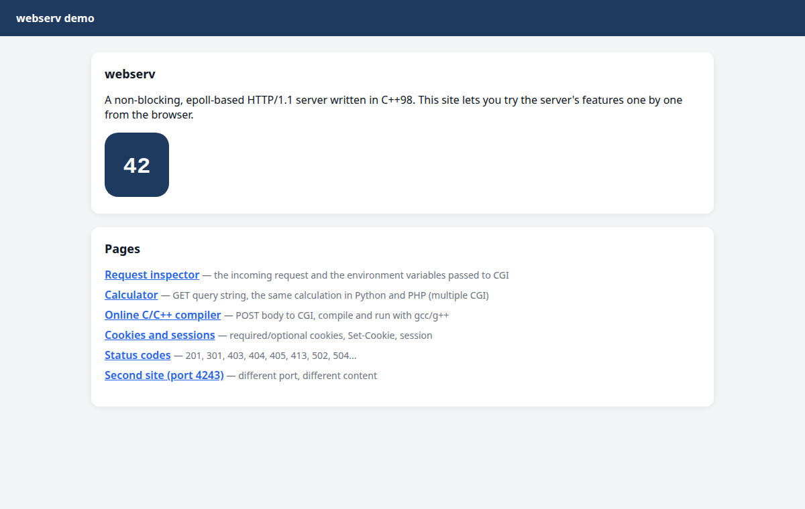
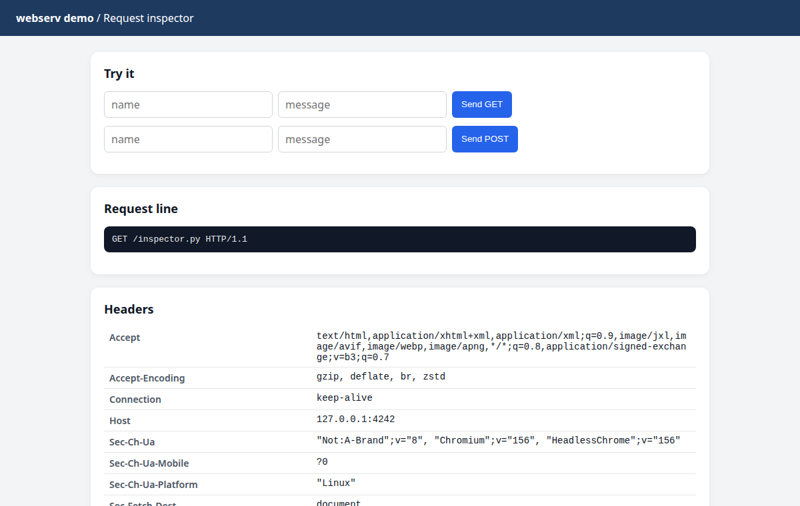
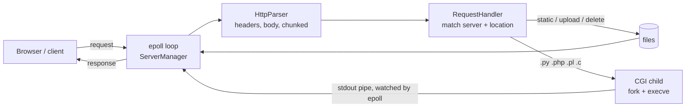

<div align="center">

# webserv

**An HTTP web server written from scratch in C++98.**

Static sites, uploads, deletes and CGI scripts, all served from a single non-blocking `epoll` loop.




</div>

## Contents

- [Features](#features)
- [Quick start](#quick-start)
- [How it works](#how-it-works)
- [Configuration](#configuration)
- [Tests](#tests)
- [Project layout](#project-layout)
- [Authors](#authors)

## Features

- **Non-blocking I/O**: one `epoll` loop handles listening sockets, clients and CGI pipes
- **nginx-style configuration**: multiple `server` blocks, several ports and hosts, per-`location` rules
- **Methods**: `GET`, `HEAD`, `POST`, `DELETE`
- **Static files** with index files, directory listing (`autoindex`) and correct MIME types
- **File uploads** (request body saved to `upload_store`) and file deletion
- **Chunked transfer encoding** for request bodies
- **CGI** via `fork` + `execve`: Python, PHP (`php-cgi`), Perl and C scripts, chosen by file extension
- **Redirects** (`return 301 /new`), custom error pages and body size limits
- **Timeouts**: idle connections are closed after 30 s, hung CGI scripts are killed and answered with `504`
- **Cookies and sessions** (bonus), shown in the demo site

## Quick start

```sh
git clone https://github.com/ifrankerem/webserv.git
cd webserv
make
./webserv conf/demo.conf
```

Open <http://127.0.0.1:4242>. Needs a C++98 compiler and Linux (`epoll`).
The CGI examples also need `python3`, `php-cgi`, `perl` and `cc`.

The demo site lets you try each feature from the browser:

| Page | Shows |
|---|---|
| Request inspector | the parsed request and the environment passed to CGI |
| Calculator | the same query handled by a Python and a PHP script |
| Online C/C++ compiler | a POST body sent to CGI, compiled and run with gcc/g++ |
| Cookies and sessions | `Set-Cookie` and a server-side session |
| Status codes | 201, 301, 403, 404, 405, 413, 502, 504 |
| Second site | another `server` block on port 4243 |

<div align="center">

</div>

## How it works



1. `ServerManager` opens one listening socket per `listen` address and waits on all of them with `epoll`.
2. Each client is read in pieces. `HttpParser` builds the request, including chunked bodies, without blocking.
3. `RequestHandler` picks the `server` block and the longest matching `location`, then checks the method and body size.
4. Static files, uploads and deletes are answered directly. CGI scripts run in a child process; their output pipe is
   added to the same `epoll` loop, so a slow script never blocks other clients.
5. The response is written back when the socket is ready. Idle clients and hung scripts are cleaned up by a timeout check.

## Configuration

```nginx
server {
    listen 127.0.0.1:4242;
    server_name localhost;
    client_max_body_size 10M;
    error_page 404 /404.html;

    location / {
        root demo;
        index index.html;
        allow_methods GET POST;
        cgi .py /usr/bin/python3;
        cgi .php /usr/bin/php-cgi;
    }

    location /uploads {
        root demo;
        allow_methods GET POST DELETE;
        upload_enable on;
        upload_store demo/uploads;
        autoindex on;
    }

    location /old {
        return 301 /;
    }
}
```

| Directive | Where | Meaning |
|---|---|---|
| `listen` | server | `host:port` to bind |
| `server_name` | server | virtual host name |
| `client_max_body_size` | server, location | max request body (`100`, `10K`, `10M`) |
| `error_page` | server | custom page for a status code |
| `root` / `alias` | location | where files are served from |
| `index` | location | default file for a directory |
| `allow_methods` | location | allowed methods; others get `405` |
| `autoindex` | location | `on` to list directories |
| `upload_enable` / `upload_store` | location | accept uploads and where to save them |
| `cgi` | location | extension and interpreter, e.g. `cgi .py /usr/bin/python3;` |
| `return` | location | redirect, e.g. `return 301 /;` |

More examples are in [`conf/`](conf).

## Tests

```sh
make test                      # unit tests: config, parser, router, static, upload, CGI
python3 tests/eval/e2e.py      # end-to-end tests against a real ./webserv process
make 42                        # official 42 tester on conf/tester_42.conf
```

`tests/eval/e2e.py` also accepts `--heavy`, `--siege`, `--valgrind`, `--bonus` and `--nc`.
Each check maps to a rule in [`EVAL_RULES.md`](EVAL_RULES.md).

## Project layout

```
src/core/    config parsing, MIME types, helpers
src/event/   epoll loop (ServerManager) and per-client state
src/http/    request parser, routing, responses, CGI
conf/        example configurations
demo/        demo site with CGI pages
tests/       unit and end-to-end tests
```

## Authors

- Mustafa Emre Yılmaz ([@muyilma](https://github.com/muyilma))
- İrfan Kerem Arslan ([@ifrankerem](https://github.com/ifrankerem))
